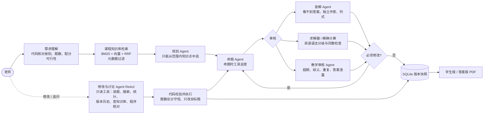

# exam-agent：中小学对话式试卷编制助手

老师用一句话出卷，再用对话修改、追问、讨论试卷，最后导出学生版和答案版 PDF。
系统由多个 Agent 分工完成：需求理解、课程知识库检索、规划、命题、审核与返修。每道题都会标注**被验证到什么程度**，无法自动核对的题交给老师确认。

覆盖范围：数学，英语一至七年级（人教版教材 + 义务教育课程标准）。

## 演示

**数学：出卷 → 查看验证状态 → "早晨的气温这题太简单了，换一个"”地球与太阳太难了，换一个"（按内容指代换题）→ "算了，两题都换回来" → 导出 PDF**

https://github.com/user-attachments/assets/fae237c8-77e8-42db-8cea-157342c0e056

**英语：出卷 → “Tom 这篇太难了，换一个” → 指代不明时先追问，不猜着改 → “19 题，换篇文章” → 只替换这一题 → 导出 PDF**

https://github.com/user-attachments/assets/02041d9c-6401-4646-af17-fc6153d4ea5f

## 功能

- **一句话出卷**：说出年级、册别或单元、题数、满分、题型要求即可。没说的部分按固定规则补全，并在"系统假设"中列出来。
- **对话修改**：可以按题号或按内容指代，例如"把讲买苹果的那道题改简单点"。支持的操作：
  - 换题、改题型、增删题、调整分值；
  - 扩大题数（原题保留）；
  - 局部改字（如"第 12 题的 15 改成 18"），改完重新核对答案；
  - 把某一道题恢复到旧版本，不影响其他题后来的修改；
  - 撤销上一次修改。
- **讨论试卷**：例如"第 7 题答案为什么是 B？""这份卷有没有超纲的题？""选择题答案是不是太集中了？"。助手会先查阅原题、统计数据或知识库，再回答，不会擅自改卷。
- **持续约束**：例如"计算题答案都要是整数"。现有题目会自动核验，不满足的只返修那几道。
- **验证状态**：每道题标注"工具验证 / 独立复核一致 / 待老师确认 / 存在未解决问题"，老师核对后可以点"确认"。
- **版本管理**：每次修改都保存为新版本，可以查看历史、比较差异。
- **导出 PDF**：学生版和答案版（含解析、验证情况、双向细目表）。
- **网页与命令行**：网页实时显示每一步进度，也可以通过临时链接公开访问。

## 优势与测试数据

### 1. 能出卷、能修改，失败时也有交代

- 构造了 100 条未参与调参的出卷请求（留出集），说法各不相同：年级写法、册别、单元、题数 5～40、满分 50～120、题型要求、口语化说法。其中 6 条应当被拒绝，例如语文卷、八年级数学、分数凑不成的配分。
- 每份成功出卷的试卷，再由程序自动发出两条修改指令，并用代码检查修改结果是否正确。

| 指标 | 结果 |
|---|---|
| 出卷成功率 | **98%**（92/94） |
| 不支持的请求正确拒绝 | **100%**（6/6），会说明支持范围或凑不成的原因 |
| 自动修改成功率 | **97%**（178/184）：换题 91/92、改回旧版 20/21、扩大题数 21/21、局部改字 12/12、提问 24/24 |
| 速度与成本 | 每份卷约 32 秒、2.4 万 token；每次修改约 9 秒、1.2 万 token（deepseek-flash） |

个别题经过多轮返修仍不通过时，标为"存在未解决问题"交给老师，整卷照常保存，不会因为一道题失败而整卷报错。

### 2. 每道题都标明验证程度

| 验证状态（留出集 1272 题） | 占比 |
|---|---|
| 工具验证：求解器独立算出答案，与题目答案一致 | 32.9% |
| 独立复核一致：看不到答案的盲解 Agent 独立作答，结果一致 | 57.9% |
| 待老师确认：没有工具能核对 | 6.8% |
| 存在未解决问题 | 2.4% |

人工随机抽检 60 题，没有发现答案错误（95% 置信下限约 94%）。

### 3. 模型列式，工具计算

审核由三部分组成：看不到答案的**盲解 Agent** 独立作答并列出算式，**精确求解器**负责计算，**教学审核 Agent** 检查超纲、歧义、重复和答案泄露。在 40 道标注题上做了消融实验（每种配置重复 3 次）：

| 审核方式 | 缺陷检出率 | 误报率 | 其中：答案计算错误检出率 |
|---|---|---|---|
| 单模型自查（看得到答案） | 78% | 2% | 38% |
| 盲解 + 求解器 | 83% | 0% | **96%** |
| 盲解 + 求解器 + 教学审核 | **100%** | **0%** | 100% |

实验中观察到：盲解 Agent 自己算出的答案经常是错的，但它列出的方程是对的，求解器据此计算全部正确。所以配分、题数统计、回复里的数字，也都以程序结果为准。

### 4. 课程知识库约束出卷范围

- 知识库按"年级 → 册 → 单元 → 知识点"组织：数学 137 张卡片、英语 64 张，另有课标条目。
- 规划 Agent 只能从出卷范围内的卡片中选择知识点，由代码校验。超纲按知识点在教材中的先后顺序判断。
- 英语：语法按课标分级严格检查；阅读短文的长度和生词比例按年级控制。
- 检索方式：元数据过滤 + BM25 + 向量（bge-small-zh）+ RRF 融合。

| 检索方式（63 条分类查询） | Hit@1 | MRR | 延迟 |
|---|---|---|---|
| 仅 BM25 | 83% | 0.871 | 0.1 ms |
| 仅向量 | 83% | 0.891 | 5 ms |
| **BM25 + 向量（RRF）** | **86%** | **0.907** | 5 ms |
| RRF + 交叉编码器重排 | 81% | 0.876 | 1165 ms |

- 向量检索把口语化查询的召回率从 77% 提高到 95%；BM25 保证专有术语和超纲内容 100% 命中。
- 重排在知识卡片这类短文本上反而变差，因此默认关闭。

### 5. 修改与讨论：按需查阅（ReAct）

- 出卷流程和答案验证由代码编排。修改与讨论环节使用 ReAct：模型只能调用只读工具（读题、全卷搜索、统计、版本历史、查知识库、程序核对），修改方案由代码校验后执行，模型不直接写数据库。
- 停止条件：步数上限、工具调用次数上限、重复调用检测。
- 上下文控制：一开始只看每题一行的索引，全文按需读取，较早的查询结果压缩成摘要。

| 修改与讨论规划（18 条留出集指令 × 3 次） | 正确率 | 每条 token |
|---|---|---|
| 一次调用（只看试卷摘要） | 67% | 1348 |
| **ReAct（按需查阅）** | **100%** | 7517 |

只看摘要时，模型会自信地答错，例如"没有需要确认的题"（实际有）。按需查阅后这类问题消失，代价是 token 约为 5.6 倍。

### 6. 状态可靠、可追溯

- 试卷的准确状态保存在 SQLite 版本快照中，不依赖对话记忆；提交时做乐观并发控制。
- 内容指纹证明未要求修改的题一个字没变。撤销是把旧内容提交为新版本，历史不改写。
- 每一步的模型调用、工具结果、返修原因都写入运行轨迹，并实时推送到网页。
- 184 个离线测试，全部用脚本化的假模型运行，不花钱、可复现。

## 系统架构



项目的开发流程见 [docs/开发流程.md](docs/开发流程.md)。

## 技术栈

Python 3.11+ · DeepSeek（OpenAI SDK；JSON 模式与原生函数调用）· Pydantic · FastAPI + SSE · SQLite ·
fastembed（bge-small-zh，本地 ONNX）· 自实现 BM25 / RRF · ReportLab · pytest

Agent 编排层是自己实现的，没有使用 LangChain / LangGraph，因此每一步的停止条件、重试和校验都完全可控，所有模型调用都可以替换成假模型来测试。

## 快速开始

1. 安装 Python 3.11 或更高版本，然后安装依赖：

   ```bash
   git clone https://github.com/<用户名>/exam-agent.git
   cd exam-agent
   python -m venv .venv
   .venv\Scripts\activate            # macOS / Linux：source .venv/bin/activate
   pip install -r requirements.txt
   pip install -e .
   ```

2. 复制 `.env.example` 为 `.env`，填入 DeepSeek API Key。检查连通性：

   ```bash
   python -m exam_agent ping
   ```

3. 启动网页，在浏览器打开 http://127.0.0.1:8000：

   ```bash
   python -m exam_agent web
   ```

   需要让别人临时访问时，可以用 Cloudflare 隧道：`cloudflared tunnel --url http://localhost:8000`。

4. 命令行用法：

   ```bash
   python -m exam_agent chat                     # 对话式出卷与修改
   python -m exam_agent export <paper_id>        # 导出 PDF
   python -m pytest -q                           # 离线测试（不调用模型）
   ```

> Windows 终端中文乱码时，先执行 `chcp 65001`。第一次运行会下载向量模型（约 100 MB）；下载慢时，可以在 `.env` 中设置 `HF_ENDPOINT=https://hf-mirror.com`。

## 复现测试数据

```bash
python -m exam_agent eval-e2e --workers 4 --dataset holdout   # 端到端：批量出卷 + 程序自动修改
python -m exam_agent eval-edit --split holdout --repeats 3    # 修改与讨论：一次调用 vs ReAct
python -m exam_agent eval-review                              # 审核消融：自查 / 盲解 + 求解器 / 完整审核
python -m exam_agent eval-retrieval                           # 检索：BM25 / 向量 / RRF / 重排
```

结果保存在 `evals/results/`。端到端评测会同时导出随机 60 题的人工核对表。

评测数据分为开发集和留出集：开发集用于改进系统；留出集只在最后评测一次，上面的数字都来自留出集（审核与检索实验除外）。模型输出有随机性，重新运行的结果会有小幅波动。

## 目录结构

```text
src/exam_agent/
  pipeline.py          出卷流程：需求 → 检索 → 规划 → 命题 → 审核 → 保存
  editing.py           对话式修改：代码校验、局部重出、单题恢复、局部改字、版本提交
  agents/              需求理解、规划、命题、盲解、教学审核、修改与讨论（ReAct）
  review.py, verify.py 审核返修闭环；验证路由与验证状态
  tools/               线性方程求解器、精确计算、英语语法分级与词数检查
  retrieval/           知识库模型、BM25、向量、RRF 融合、重排
  grounding.py         确定出卷范围与候选知识点
  scoring.py           配分求解器
  store.py             SQLite 版本快照与运行轨迹
  export_pdf.py        学生版 / 答案版 PDF
  web/                 FastAPI + SSE 网页
  experiments/         评测
kb/                    课程知识库（数学、英语）
evals/                 评测数据集（开发集 / 留出集）
tests/                 离线测试
docs/                  设计说明、开发流程
```

## 局限

- 不支持配图：需要看图作答的题型不在自动出题范围内。
- 盲解 Agent 默认与命题 Agent 使用同一个模型，两者可能犯同样的错误，所以"独立复核一致"不等于一定正确。可以在 `.env` 中为盲解单独配置另一个模型。
- 测试请求和标注数据由作者构造，规模有限；只测试了 deepseek-flash。
- 数学知识库覆盖一年级至七年级上册，英语覆盖三至七年级。
