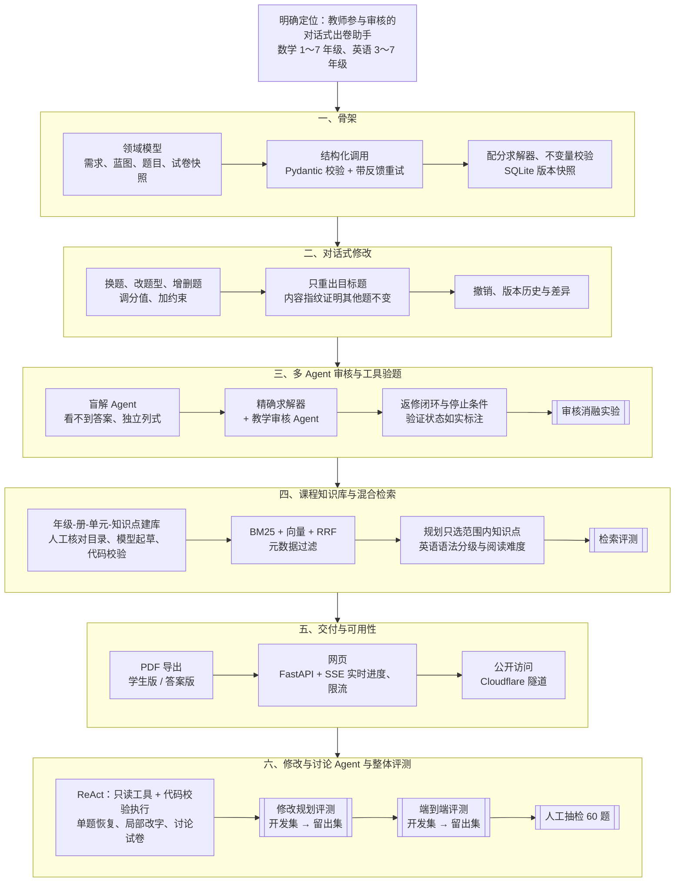
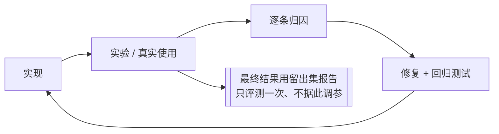

# 开发流程

项目分六个阶段完成，图中双线框表示该阶段的评测。（图片版：[开发流程.png](开发流程.png)）

每个阶段内部都按同一个循环推进：

## 各阶段的验证方式

| 阶段 | 怎么证明有效 |
|---|---|
| 骨架 | 离线测试：所有模型调用都用脚本化的假模型代替 |
| 对话式修改 | 内容指纹校验；修改场景测试 |
| 审核与工具验题 | 40 题标注集上的消融实验：答案计算错误检出率从 21%～38% 提高到 92%～96% |
| 知识库与检索 | 63 条分类查询的检索评测；用实验数据决定不启用重排 |
| 交付 | 浏览器自动化测试网页；用临时公开链接实际访问 |
| 修改与讨论、整体评测 | 留出集：修改规划正确率 67% → 100%；端到端出卷 98%、修改 97%；人工抽检 60 题 |
